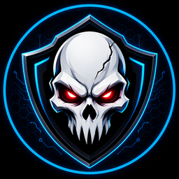

  

<h1 align="center">Mohaskull Game Booster</h1>

  <b>يجهّز جهازك للعب تلقائياً ويشرح لك بالعربي سبب التقطيع</b> 
  Auto game boost, pro overlay and session diagnosis for Windows

  <a href="../../releases/latest"><b>⬇ تحميل آخر إصدار / Download the latest version</b></a>

---

## ✨ المميزات
- **اكتشاف الألعاب تلقائياً:** عند تشغيل أي لعبة يجهّز البرنامج الجهاز (خطة الطاقة، Game Mode، إغلاق برامج الخلفية، أولوية اللعبة)، ويرجع كل شيء كما كان بعد إغلاقها.
- **تسجيل الجلسات والتشخيص:** كل جلسة لعب تُسجّل ثانية بثانية، ثم يشرح لك البرنامج **سبب** التقطيع أو هبوط الفريمات: حرارة، معالج، كرت، قرص، إنترنت، أو برنامج في الخلفية.
- **أوفرلاي احترافي بستة أشكال:** FPS، و1% Low، ورسم الفريمات، والمعالج، والكرت، والرام، والبنق. ويعمل داخل الألعاب بوضع Fullscreen عبر RivaTuner.
- **حد فريمات ذكي** لـ VALORANT و Deadlock، محسوب من جلساتك الفعلية.
- **بدون أي Driver:** آمن مع مضادات الغش مثل Vanguard.
- واجهة **عربية وإنجليزية** كاملة.

## 💻 المتطلبات
- Windows 10 أو 11 (64-bit).
- صلاحيات المسؤول، لتغيير خطة الطاقة وقراءة الفريمات.

| الميزة | الأجهزة |
|---|---|
| التعزيز، الفريمات، التشخيص، الأوفرلاي | كل الأجهزة |
| قراءة كرت الشاشة | NVIDIA (كاملة)، AMD و Intel (الاستخدام والذاكرة) |
| حرارة المعالج، الوضع الحراري الذكي، Cooler Boost | لابتوبات MSI |
| أوفركلوك الكرت | يحتاج MSI Afterburner (متوقف افتراضياً) |

## 🚀 التثبيت
من [آخر إصدار](../../releases/latest) حمّل أحد الملفين:

| الملف | لمن؟ |
|---|---|
| **`Mohaskull-Game-Booster-Setup.exe`** ⭐ | مثبّت كامل: اختصار في قائمة ابدأ، وإلغاء تثبيت من إعدادات ويندوز **يرجع كل الإعدادات كما كانت** |
| `Mohaskull-Game-Booster-Portable.exe` | نسخة محمولة بدون تثبيت: ضعها في مجلد خاص بها وشغّلها |

إذا ظهرت رسالة **Windows protected your PC** اضغط **More info** ثم **Run anyway**. بعدها شغّل أي لعبة، والبرنامج يتولى الباقي.

**التحديثات تلقائية:** عند صدور إصدار جديد يظهر زر «تحديث» أعلى نافذة البرنامج. اضغطه فيتحدث البرنامج ويعيد تشغيل نفسه.

**واجهت مشكلة؟** من البرنامج: «حول» ← **«إرسال تقرير مشكلة»**. يجهّز ملفاً على سطح المكتب ويفتح صفحة [الإبلاغ](../../issues/new/choose) لترفقه.

## 🔒 الخصوصية
كل البيانات تبقى على جهازك، والبرنامج لا يرسل أي معلومات. اتصاله بالإنترنت فقط لقياس البنق (إلى 1.1.1.1) وفحص التحديثات من GitHub.

---

## English
**Mohaskull Game Booster** detects your games, tunes Windows while you play and restores everything afterwards.
Every session is recorded and diagnosed, so you learn *why* you got stutters or FPS drops.

- Auto boost: power plan, Game Mode, background apps, game priority, restored after the game.
- Session recording and diagnosis (CPU heat, CPU or GPU bound, disk, network, background apps).
- Pro overlay with 6 styles, plus in-game overlay through RivaTuner.
- No kernel driver, so it is safe with anti-cheat (Vanguard and others).
- One-click auto updates.

**Install:** download `Mohaskull-Game-Booster-Setup.exe` (recommended: Start menu shortcut, and uninstalling restores every Windows setting)
or the portable `Mohaskull-Game-Booster-Portable.exe` from the [latest release](../../releases/latest).
Found a bug? In the app: About → **Report a problem**, then attach the file to a [new issue](../../issues/new/choose).

**Requirements:** Windows 10/11 64-bit, administrator rights. CPU temperature and thermal features need an MSI laptop.
GPU readings: full on NVIDIA, usage and memory on AMD / Intel.

**Privacy:** all data stays on your PC. Network use: ping test to 1.1.1.1 and the GitHub update check.

---
© 2026 Mohaskull. All rights reserved. Provided "as is", without warranty of any kind.
